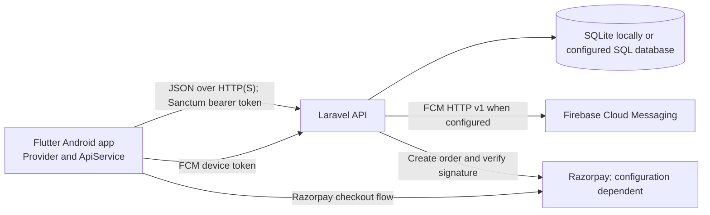

# Nivora: Smart Society Management System

<p align="center">
  
</p>

<p align="center"><strong>One place for everyday residential society operations.</strong></p>

<p align="center">
  <a href="https://flutter.dev"></a>
  <a href="https://laravel.com"></a>
  <a href="https://www.php.net"></a>
</p>

Nivora is a residential society management application with a Flutter Android client and a Laravel JSON API. The application supports resident, security, staff, and administrator workflows for visitor access, maintenance dues, parcels, complaints, notices, and other society operations.

The source repository is [Swanand-Pawar-94/smart-society-final](https://github.com/Swanand-Pawar-94/smart-society-final), with the mobile client in `mobile/` and backend in `backend/`. The configured production API domain is [smartsociety.codevizor.com](https://smartsociety.codevizor.com). Its public health endpoint returned HTTP 200 during a check on 2026-10-19. That confirms the endpoint was responding; it does not verify every production workflow, its hosting provider, or payment and Firebase credentials.

## Contents

- [Project scope](#project-scope)
- [Implemented workflows](#implemented-workflows)
- [Feature directory](#feature-directory)
- [Main application modules](#main-application-modules)
- [Roles and access](#roles-and-access)
- [Architecture and technology](#architecture-and-technology)
- [Repository layout](#repository-layout)
- [Data model](#data-model)
- [API overview](#api-overview)
- [Local development](#local-development)
- [Configuration](#configuration)
- [Notifications](#notifications)
- [Payments](#payments)
- [Deployment status](#deployment-status)
- [Tests](#tests)
- [Security notes and known limitations](#security-notes-and-known-limitations)
- [Documentation and quick navigation](#documentation-and-quick-navigation)
- [Contributing and maintenance](#contributing-and-maintenance)

## Project scope

The system replaces several manual society processes with authenticated mobile workflows and backend records. Residents can manage visitors, view bills, and use community services. Security users manage gate activity. Administrators manage society records and operations. Staff can work with assigned operational modules exposed to their role.

The backend is designed for a single society. No multi-tenant society isolation is present in the current schema.

### Problem and objectives

Society workflows such as visitor approvals, dues tracking, parcel logging, and issue follow-up can otherwise be split across paper registers, calls, and informal messages. Nivora provides shared mobile and API workflows with role-scoped records and a persistent history. Its implementation objectives are to centralize those records, make gate and resident actions traceable, and give administrators operational views of the society data managed by the application.

## Implemented workflows

The items below are based on current Flutter screens/API calls, Laravel routes and services, and the feature tests present in the repository. They describe implemented application workflows; they do not imply that external production credentials or every live integration have been verified.

| Area | Current implementation |
| --- | --- |
| Authentication | Login, registration, password reset endpoints, profile retrieval/update, Sanctum bearer tokens, and client token persistence through `flutter_secure_storage`. Role checks protect API routes. |
| Residents, flats, society | Administrator API operations manage residents and flats. Resident profiles and dashboards are scoped to the signed-in account/unit. |
| Visitors | Residents can view, pre-approve, approve, and reject visitors. Security can create gate requests, record entry and exit, and view checked-out history. Tests cover role restrictions and duplicate check-in/out rejection. |
| Notifications | In-app notifications and device-token registration are implemented. Visitor workflow tests cover database notifications and graceful handling of push failures. Live push delivery depends on Firebase configuration. |
| Maintenance | Admins manage bills and can generate bills through the API/Artisan command. Residents can view dues, payment orders, payment history, summaries, and receipts. The Flutter client includes invoice/PDF and payment screens. |
| Parcels | Security or staff can record parcels; residents can view their own parcel records; authorized users can mark parcels collected. |
| Complaints | Residents create and update their complaints; admins and staff can view and update complaints according to role and record scope. Feature tests cover ownership and updates. |
| Notices | Administrators create and publish notices with audience and publication lifecycle fields. Residents, staff, and security have role-scoped read routes. Tests cover draft visibility and expiry. |
| Dashboards and reports | Resident, security, staff, and administrator dashboard endpoints exist. Administrator reporting includes maintenance, complaints, visitors, occupancy, parking, and staff data. |
| Parking and amenities | Admin routes manage parking slots and amenities. Residents can view slots and create/cancel amenity bookings; admins can manage booking status. |
| Messaging | Authenticated conversation and message endpoints and Flutter conversation views are present. The repository does not configure a real-time broadcasting transport, so this is documented as API-backed messaging rather than live chat. |
| Penalties | Security can submit a violation report (including evidence); administrators manage rules and decide reports/appeals; residents can view their records, appeal, and submit payment. Feature tests cover authorization, evidence access, decisions, and payment idempotency. |

The codebase also contains staff management and selection-option endpoints. Avoid assuming that every administrative operation has a dedicated Flutter screen: several mobile record/form workflows are implemented through shared module screens. The [feature catalog](docs/FEATURES.md) distinguishes implemented behavior from partial integrations and known limits.

## Feature directory

Each link opens the dedicated implementation-backed explanation in [docs/FEATURES.md](docs/FEATURES.md). The catalog records status, role access, current screen paths, steps, backend behavior, relevant data, outcomes, limits, and existing tests.

| Feature | Detailed guide |
| --- | --- |
| Sign-in, registration, account access | [Authentication](docs/FEATURES.md#sign-in-registration-and-account-access) |
| Role navigation and API permissions | [Role access](docs/FEATURES.md#role-access-and-navigation) |
| Profiles, residents, units | [Profiles](docs/FEATURES.md#profiles-and-resident-records), [Units](docs/FEATURES.md#units-and-society-records) |
| Role dashboards | [Resident](docs/FEATURES.md#resident-dashboard), [Security](docs/FEATURES.md#security-dashboard), [Administrator](docs/FEATURES.md#administrator-dashboard), [Staff](docs/FEATURES.md#staff-workspace) |
| Visitor approval and gate operations | [Visitor requests](docs/FEATURES.md#visitor-requests-and-pre-approval), [Check-in/out and history](docs/FEATURES.md#gate-check-in-check-out-and-history) |
| Maintenance and resident payments | [Bills and invoices](docs/FEATURES.md#maintenance-bills-and-invoices), [Payment tracking](docs/FEATURES.md#payment-tracking-and-history), [Razorpay](docs/FEATURES.md#razorpay-payments), [Payment administration](docs/FEATURES.md#payment-administration-and-resident-transactions) |
| Penalties | [Rules](docs/FEATURES.md#penalty-rules), [Reports and decisions](docs/FEATURES.md#penalty-reports-and-decisions), [Appeals and payment](docs/FEATURES.md#penalty-appeals-and-payment) |
| Community operations | [Parcels](docs/FEATURES.md#parcels), [Complaints](docs/FEATURES.md#complaints), [Notices](docs/FEATURES.md#notices), [Staff management](docs/FEATURES.md#staff-management), [Parking](docs/FEATURES.md#parking), [Amenities and bookings](docs/FEATURES.md#amenities-and-bookings) |
| Notifications, reports, messaging, diagnostics | [Notifications](docs/FEATURES.md#in-app-and-push-notifications), [Reports](docs/FEATURES.md#reports-and-analytics), [Messaging](docs/FEATURES.md#messaging), [Diagnostics](docs/FEATURES.md#diagnostic-and-emergency-actions) |

## Main application modules

### Accounts and role-based workspaces

Users sign in with an email address or mobile number and a password. The client obtains a Sanctum bearer token and stores it securely; Laravel separately checks role and record access on protected routes. Resident, security, administrator, and staff users see different navigation. Registration supports resident, staff, and security accounts, while staff/security activation and administrator provisioning have separate controls. See [account access](docs/FEATURES.md#sign-in-registration-and-account-access) and [roles](docs/FEATURES.md#role-access-and-navigation).

### Residents, units, and dashboards

Administrators manage resident and unit records; a resident’s `My Unit` view is scoped to their account. Role dashboards summarize operational data and link into the relevant modules. Dashboard cards are summaries: visitor, finance, complaint, parcel, and penalty states must be confirmed in their module. The project schema supports one society rather than multiple isolated societies. See [profiles](docs/FEATURES.md#profiles-and-resident-records), [units](docs/FEATURES.md#units-and-society-records), and the individual dashboard guides in the feature directory above.

### Visitor access and gate operations

Residents can pre-approve visitors or respond to pending requests. Security records gate requests and checks in approved eligible visitors; check-out closes the visit and preserves history. The API rejects invalid or duplicate state transitions. The Security dashboard’s `Vehicle entry` currently follows the visitor intake flow and does not record a vehicle plate; `Emergency alert` only shows local confirmation and has no verified server dispatch. See [visitor requests](docs/FEATURES.md#visitor-requests-and-pre-approval) and [gate actions](docs/FEATURES.md#gate-check-in-check-out-and-history).

### Maintenance, dues, and payment records

Administrators maintain bills; residents view invoices, outstanding balances, payment history, and transaction activity. Selected bills use server-calculated checkout totals. Manual payment submissions and gateway payments have separate statuses and should not be treated as settled until backend history confirms the result. Razorpay order/signature verification is implemented, but live production credentials and transactions are unverified. See [maintenance bills](docs/FEATURES.md#maintenance-bills-and-invoices), [payment tracking](docs/FEATURES.md#payment-tracking-and-history), and [Razorpay limitations](docs/FEATURES.md#razorpay-payments).

### Penalties and violations

Security can file violation reports with details and evidence; administrators review the report and may issue a warning, approve a charge, or reject it. Residents can see assigned penalties and submit appeals. Rule fields for amount bounds, grace, and evidence are stored but not all are enforced by the decision path; an admin-entered decision amount is operative. The report-list endpoint also has a role-scoping caveat documented in the [feature guide](docs/FEATURES.md#penalty-reports-and-decisions).

### Community operations

Residents can submit complaints, browse notices, record/view parcels according to role, view parking information, and request amenity bookings. Admin/staff/security actions depend on the module and role. Amenity bookings enforce active status, valid time order, and conflicts, but a live availability calendar and opening-hour checks are not verified. Parcel collection has a concurrency/notification caveat. See [parcels](docs/FEATURES.md#parcels), [complaints](docs/FEATURES.md#complaints), and [amenities](docs/FEATURES.md#amenities-and-bookings).

### Notifications, reports, and messages

Database notifications and read-state controls are implemented. FCM token registration and send services exist, but live push delivery requires Firebase configuration and has not been verified in production. Administrator reports summarize operations for selected periods. Messaging persists conversations/messages, but no real-time transport or create-conversation interface is configured. See [notifications](docs/FEATURES.md#in-app-and-push-notifications), [reports](docs/FEATURES.md#reports-and-analytics), and [messaging](docs/FEATURES.md#messaging).

## Roles and access

The `role` middleware enforces role names at the API boundary. Controllers and policies apply additional ownership checks for sensitive records.

| Role | Main access |
| --- | --- |
| `RESIDENT` | Own profile/unit, visitor approvals and pre-approvals, bills and payments, complaints, notices, parcels, parking information, bookings, notifications, and penalty records/appeals. |
| `SECURITY` | Security dashboard, visitor intake and gate entry/exit, parcel intake/collection, notices, and penalty reports. |
| `STAFF` | Staff dashboard, assigned/visible complaint workflows, parcel operations, notices, and staff options. |
| `ADMIN` | Resident/flat records, dashboards/reports, bills and payment administration, visitors, complaints, notices, staff, parking, amenities, parcels, and penalty rules/reviews. |

## Architecture and technology



**Backend:** PHP 8.3+, Laravel `^13.8`, Laravel Sanctum, Eloquent, PHPUnit 12.

**Mobile:** Flutter/Dart (`>=3.4.0 <4.0.0`), Provider, `http`, `flutter_secure_storage`, Firebase Messaging, local notifications, PDF/printing, and Razorpay Flutter SDK.

**Database:** Laravel supports SQLite and MySQL/MariaDB connections in its configuration. The committed deployment example is configured for MySQL. The production database engine was not independently verified during this README update.

## Repository layout

```text
SmartSociety/
├── backend/
│   ├── app/                  # Models, API controllers, middleware, services, policies
│   ├── database/migrations/  # Schema migrations and seeders
│   ├── routes/               # API, web, and scheduled command definitions
│   ├── tests/                # PHPUnit feature and unit tests
│   ├── .env.example
│   └── composer.json
├── mobile/
│   ├── android/              # Android manifest, Gradle setup, launcher resources
│   ├── assets/               # Fonts and images
│   ├── lib/                  # Flutter app, screens, API, state, and services
│   ├── test/                 # Flutter tests
│   └── pubspec.yaml
├── deployment/               # Deployment guide, environment template, SQL dump
├── docs/                      # User guide, feature catalog, and technical docs
├── PHYSICAL_DEVICE_SETUP.md
└── README.md
```

## Data model

The authoritative schema is defined by the Laravel migrations in `backend/database/migrations/`. Core records include:

- Users, Sanctum personal access tokens, profiles, residents, and flats.
- Visitors and database notifications, plus user device tokens for FCM.
- Maintenance bills/payments, payment orders/items, receipts, resident transactions, and transaction ledger entries.
- Parcels, staff members, complaints and complaint status history, notices, parking slots, amenities and bookings.
- Conversations, participants, and messages.
- Penalty rules, violation reports/evidence, penalties, appeals, and audit logs.

Use migrations to create or update a local database. The SQL dump in `deployment/database/` is a separate deployment artifact and may not track later migrations; compare it with the migration set before relying on it for a new installation.

## API overview

The API is prefixed with `/api`. Authenticated routes use a Sanctum bearer token (`Authorization: Bearer <token>`), with role middleware on role-specific operations.

| Method and path | Access | Purpose |
| --- | --- | --- |
| `GET /api/health` | Public | API health response and database connection check. |
| `POST /api/auth/login` | Public | Sign in and obtain an API token. |
| `POST /api/auth/register` | Public | Register an account. |
| `GET /api/auth/me` | Authenticated | Current authenticated user. |
| `POST /api/auth/logout` | Authenticated | Revoke the current token. |
| `GET /api/resident/dashboard` | Resident | Resident dashboard. |
| `GET /api/security/dashboard` | Security | Security dashboard. |
| `GET /api/staff/dashboard` | Staff | Staff dashboard. |
| `GET /api/admin/dashboard` | Admin | Administrator dashboard. |
| `/api/resident/visitors` | Resident | Visitor listing, approvals, rejections, and pre-approvals. |
| `/api/security/visitors` | Security | Gate visitor intake, listing, entry, and exit. |
| `/api/resident/maintenance-bills` | Resident | Bills and bill details. |
| `/api/resident/payments/create-order` and `/api/resident/payments/verify` | Resident | Payment gateway order creation and signature verification. |
| `/api/device-tokens` | Authenticated | Register or deactivate an FCM device token. |
| `/api/penalty-reports` and `/api/admin/penalty-*` | Role-scoped | Penalty reporting, rule administration, and decisions. |

Other routes cover parcels, complaints, notices, parking, amenities, messaging, reports, payment records, and notifications. The complete route definitions are in `backend/routes/api.php`.

## Local development

### Prerequisites

- PHP 8.3 or newer and Composer.
- A database supported by the backend configuration (SQLite or MySQL/MariaDB) and the matching PHP PDO extension.
- Flutter SDK compatible with the Dart constraint in `mobile/pubspec.yaml`; Android SDK for Android builds.

### Backend

```powershell
cd backend
composer install
Copy-Item .env.example .env
```

Edit `backend/.env` for local development before starting: set a local `APP_ENV`, keep `APP_DEBUG` enabled only locally, set a unique `APP_KEY` using the command below, and configure the database connection and credentials for your machine. The checked-in example contains production-oriented placeholders; do not use those placeholder values as real credentials.

```powershell
php artisan key:generate
php artisan migrate
php artisan serve --host=0.0.0.0 --port=8000
```

`php artisan migrate` applies schema migrations; back up any non-disposable database before running migrations against it. For a phone on the same LAN, use the development computer's reachable IP. For an Android emulator, `10.0.2.2` maps to the host machine.

### Flutter Android app

```powershell
cd mobile
flutter pub get
flutter run --dart-define=API_BASE_URL=http://<HOST-IP>:8000/api --dart-define=API_ENV=lan
```

For an Android emulator:

```powershell
flutter run --dart-define=API_ENV=emulator
```

For a USB-connected Android device with USB debugging and ADB available:

```powershell
adb reverse tcp:8000 tcp:8000
flutter run --dart-define=API_ENV=usb
```

For a release build pointed at the production API:

```powershell
flutter build apk --release --dart-define=API_ENV=production --dart-define=API_BASE_URL=https://smartsociety.codevizor.com/api
```

See [PHYSICAL_DEVICE_SETUP.md](PHYSICAL_DEVICE_SETUP.md) for the repository's device/network helper instructions.

## Configuration

### Backend environment

Laravel reads environment values from `backend/.env`; `backend/.env.example` is a template. Relevant variables include:

| Variable names | Purpose |
| --- | --- |
| `APP_ENV`, `APP_DEBUG`, `APP_KEY`, `APP_URL`, `APP_TIMEZONE` | Application environment, encryption key, URL, and timezone. |
| `DB_CONNECTION`, `DB_HOST`, `DB_PORT`, `DB_DATABASE`, `DB_USERNAME`, `DB_PASSWORD` | Database connection. Keep credentials only in the untracked server/local `.env`. |
| `MAIL_MAILER`, `MAIL_HOST`, `MAIL_PORT`, `MAIL_USERNAME`, `MAIL_PASSWORD`, `MAIL_ENCRYPTION`, `MAIL_FROM_ADDRESS` | Mail transport and sender settings. |
| `FIREBASE_PROJECT_ID`, `FIREBASE_CREDENTIALS_FILE` | Server-side FCM HTTP v1 project and private service-account file. `FIREBASE_SERVER_KEY` is also read by service configuration. |
| `PAYMENT_MODE`, `RAZORPAY_KEY_ID`, `RAZORPAY_KEY_SECRET`, `RAZORPAY_WEBHOOK_SECRET` | Payment mode and server-side Razorpay credentials/secrets. |

Do not commit `.env`, Firebase service-account JSON, signing keys, or payment secrets. The Flutter app accepts `API_BASE_URL` and `API_ENV` as compile-time `--dart-define` values. Supported presets in `ApiConfig` include `lan`, `usb`, `emulator`, and `production`; a release build defaults to the production API URL unless overridden.

## Notifications

The mobile app requests Firebase Messaging tokens, registers/refreshes them through the authenticated API, and uses local notifications for foreground messages. The backend contains an FCM HTTP v1 service and stores device-token records. Visitor lifecycle tests verify database notification behavior and that push delivery failures do not abort those workflows.

Actual push delivery requires valid Firebase client configuration in the app and server-side project/service-account configuration. The repository's `.env.example` does not list the Firebase variables, so configure those explicitly in the server environment. Production push delivery was not verified as part of this README update.

## Payments

Maintenance bills and payment tracking are implemented independently of any external gateway. Payment orders, receipts, history, and ledger records are part of the backend. The app includes Razorpay checkout integration; the backend creates orders and verifies payment signatures. A demo confirmation path is also present for development/tests.

The checked-in backend environment template sets `PAYMENT_MODE=test` and contains placeholders. No live Razorpay credentials, merchant activation, production webhook configuration, or live transaction were verified here. Treat live payment acceptance as **configuration and production verification pending**. Keep `RAZORPAY_KEY_SECRET` and `RAZORPAY_WEBHOOK_SECRET` on the backend only; never embed them in Flutter or commit them.

## Deployment status

- **Verified:** `https://smartsociety.codevizor.com/api/health` responded with HTTP 200 and the Laravel API health payload on 2026-10-19.
- **Not verified:** Hosting provider, web-server/document-root configuration, production database engine and migration level, Firebase push delivery, Razorpay live transactions, and the currently distributed mobile build.
- **Repository guidance:** `deployment/HOSTINGER_DEPLOYMENT.md` describes a Hostinger-oriented procedure and `deployment/flutter/production_config_guide.md` describes Flutter production URL configuration. Treat provider-specific examples there as deployment guidance, not proof of the live server's configuration; some examples use placeholder domains.

The production mobile API base URL is `https://smartsociety.codevizor.com/api`. The Laravel web root should point to `backend/public`, and the server must provide PHP 8.3+, Composer dependencies, writable Laravel `storage` and `bootstrap/cache`, HTTPS, and a configured database. Set actual production values in the server-side `.env`; do not expose that file under the public document root.

After deployment, migrate with a reviewed release procedure and backup. Laravel's scheduler registers `maintenance:generate` in `backend/routes/console.php`; recurring execution requires the host's Laravel scheduler entry. Confirm its cadence and idempotence against the intended billing policy before enabling it in production.

## Tests

The repository includes Laravel feature/unit tests for authentication, authorization, residents/flats, visitors, notifications, payments, complaints/notices, parcels, dashboards, and penalties, plus Flutter widget tests for login/roles, security visitor workflows, navigation, payments, penalties, and time selection.

Run the suites from their respective directories:

```powershell
cd backend
php artisan test
```

```powershell
cd mobile
flutter analyze
flutter test
```

These are verification commands, not a report of test results. The suites were not run as part of this README update.

## Security notes and known limitations

- Use HTTPS for production API traffic and set `APP_DEBUG=false` in production.
- Keep server secrets and signing material out of source control and mobile builds. Use private server-side configuration for Firebase and Razorpay credentials.
- Route middleware and model/controller ownership checks enforce role and record scope. Continue to review authorization when adding endpoints.
- Local development may use HTTP; Android cleartext traffic is enabled in the current main manifest, so do not interpret that development setting as transport security for production.
- Production health endpoint availability does not establish that external services or every user workflow are operational.
- The current schema is single-society; multi-society tenancy is not implemented.
- Messaging endpoints and screens exist, but no real-time broadcast transport is configured in the repository.
- Live FCM delivery, live Razorpay transactions, and the exact deployed Flutter APK remain unverified.

Potential future work includes multi-society tenancy, a real-time messaging transport, and production verification/operations for Firebase and Razorpay integrations.

## Documentation and quick navigation

| Guide | Use it for |
| --- | --- |
| [Feature catalog](docs/FEATURES.md) | Dedicated module-by-module behavior, roles, navigation, backend rules, data, limitations, and test inventory. |
| [Mobile app user guide](docs/USER_GUIDE.md) | Resident, security, staff, and administrator instructions for the app's verified screens and workflows. |
| [Architecture and workflows](docs/WORKFLOWS.md) | Request lifecycle, roles, authentication, module workflows, validation, side effects, and implementation caveats. |
| [API reference](docs/API_REFERENCE.md) | Endpoint methods, paths, access, request fields, validation, and behavior by module. |
| [Data model and business rules](docs/DATA_MODEL.md) | Migration-backed ER diagram, table mapping, relationships, constraints, and status rules. |
| [Deployment, testing, and security](docs/DEPLOYMENT_TESTING_SECURITY.md) | Environment configuration, deployment evidence, build/run commands, test inventory, security notes, and troubleshooting. |
| [Flutter setup](docs/FLUTTER_SETUP.md) | Existing Flutter setup notes. |
| [Physical device setup](PHYSICAL_DEVICE_SETUP.md) | Network configuration for Android devices. |
| [Hostinger deployment guide](deployment/HOSTINGER_DEPLOYMENT.md) | Existing provider-oriented deployment instructions; verify them against the live environment before use. |

### Quick navigation

- New developer: start with [Local development](#local-development), then read the [architecture and workflows guide](docs/WORKFLOWS.md).
- API integration: use the [API reference](docs/API_REFERENCE.md) and confirm authorization behavior in [roles and access](#roles-and-access).
- Schema changes: inspect Laravel migrations first and consult the [data model guide](docs/DATA_MODEL.md).
- Release preparation: review [deployment, testing, and security](docs/DEPLOYMENT_TESTING_SECURITY.md); production infrastructure and external credentials still need verification.

## Contributing and maintenance

Issues and pull requests can be opened in the [project repository](https://github.com/Swanand-Pawar-94/smart-society-final). Keep changes focused, preserve secrets and production data, and update the relevant documentation when routes, permissions, schema, environment variables, or workflows change. Run the applicable backend and Flutter checks listed in [Tests](#tests) and include their actual results in a change description. No separate contribution policy was found during this documentation pass.

This README and its supporting guides describe the inspected repository state on 2026-10-19. They should be reviewed alongside implementation changes; production behavior can differ from the code until deployment and integrations are verified.
