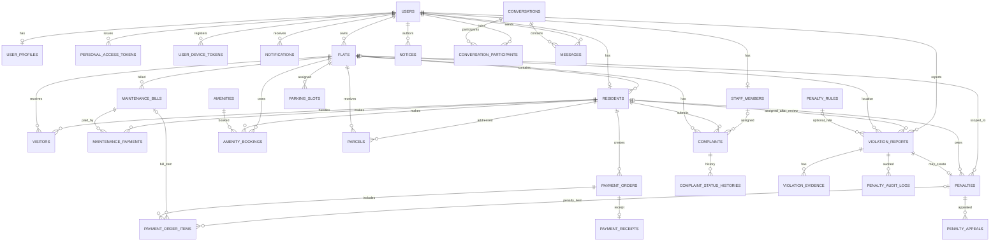

# Nivora Data Model and Business Rules

This reference is derived from `backend/database/migrations/` and Eloquent models. Migrations are authoritative for a fresh/upgraded schema; `deployment/database/smart_society.sql` is a separate dump that may lag later migrations. This document does not disclose production database identifiers or credentials.

## Core entity map

The diagram shows verified foreign-key/model relationships; `o|` denotes optionality in the schema. Some optional linkage fields (such as violation-to-bill/booking and evidence-to-appeal) are not fully constrained by database foreign keys. Inspect the migration before relying on referential integrity for those fields.

## Module-to-model and table map

| Module | Main tables / models | Purpose and key relationships |
| --- | --- | --- |
| Identity/access | `users`, `User`, `personal_access_tokens`, `user_profiles`, `UserProfile` | User role (`ADMIN`, `RESIDENT`, `SECURITY`, `STAFF`), hashed password, Sanctum tokens, one-to-one profile. |
| Flats/residents | `flats`, `Flat`; `residents`, `Resident` | Unique `(building, flat_number)`; one resident row per user; residents reference a flat; flat owner is an optional user. Multiple residents can share a flat. |
| Staff | `staff_members`, `StaffMember` | Optional one-to-one user, optional unique employee ID, active state and shift fields. Staff can be assigned to complaints. |
| Visitor access | `visitors`, `Visitor` | References flat and resident; records requester security user, optional approving resident, approval and entry state/timestamps. Indexes cover flat/resident status, entry chronology and mobile number. |
| Notifications | Laravel `notifications`, `UserDeviceToken` / `user_device_tokens` | Polymorphic database notifications, read timestamp, per-user FCM token records. |
| Maintenance | `maintenance_bills`, `MaintenanceBill`; `maintenance_payments`, `MaintenancePayment` | Bills belong to flats and have amount, charge components, month/due date/status. Payments reference bill/resident and optionally a payment order. Unique flat/month prevents duplicate bills. |
| Payment/ledger | `payment_orders`, `PaymentOrder`; `payment_order_items`, `PaymentOrderItem`; `payment_receipts`, `PaymentReceipt`; `resident_transactions`, `ResidentTransaction`; `resident_transaction_ledger` | Orders attach to resident/flat; items refer to a bill or penalty; gateway references are unique; a receipt is unique per order and receipt number. Two transaction/ledger tables store balance history and reference metadata. |
| Complaints | `complaints`, `Complaint`; `complaint_status_histories` | Complaint references resident/flat, optional assigned staff; history records from/to state, actor, note and time. |
| Notices | `notices`, `Notice` | Author user, content/audience/publication schedule/expiry and optional attachment path. |
| Parking | `parking_slots`, `ParkingSlot` | Unique slot number, type/status and optional flat plus vehicle fields. |
| Amenities | `amenities`, `Amenity`; `amenity_bookings`, `AmenityBooking` | Unique amenity name, active/time configuration; booking references amenity, resident and flat and stores date/time/status. |
| Parcels | `parcels`, `Parcel` | Flat/resident, receiving user, optional collecting user, tracking/type/status and receipt/collection timestamps. |
| Messaging | `conversations`, `Conversation`; `conversation_participants`; `messages`, `Message` | Conversation creator, unique conversation/user participant membership and last-read time, messages with sender/body/timestamp. |
| Penalties | `penalty_rules`, `PenaltyRule`; `violation_reports`, `ViolationReport`; `violation_evidence`, `ViolationEvidence`; `penalties`, `Penalty`; `penalty_appeals`, `PenaltyAppeal`; `penalty_audit_logs`, `PenaltyAuditLog` | Rule catalog, incident reports, stored evidence, one penalty per report, resident appeals, and actor/status audit history. Payment order items may instead refer to a penalty. |
| Laravel runtime | `cache`, `cache_locks`, `jobs`, `job_batches`, `failed_jobs`, `password_reset_tokens` | Framework cache, queue, and password reset support. |

## Important keys, indexes and integrity safeguards

- `flats`: unique building + flat number.
- `residents`: unique `user_id`, indexed `(flat_id, is_primary_contact)`; `user_id` cascades on delete while flat may be nulled.
- `maintenance_bills`: unique `(flat_id, billing_month)`, indexed billing month/status and due date.
- `payment_orders`: unique provider reference and gateway payment ID; order items have unique order/bill pair. Later penalty migration makes `maintenance_bill_id` nullable, adds nullable `penalty_id`, and unique order/penalty pair.
- `payment_receipts`: unique order and unique receipt number.
- `parking_slots.slot_number`, `amenities.name`, staff employee ID, and device token uniqueness are enforced by schema/model migration constraints.
- `violation_reports.incident_fingerprint` is unique and derived in code from category, violation type, flat (or zero), normalized UTC incident timestamp, and normalized location.
- `penalties.violation_report_id` is unique, limiting each report to one created penalty. Payment item uniqueness prevents repeating the same bill/penalty in an order.
- `complaint_status_histories`, `penalty_audit_logs`, and ledger tables preserve status/financial event history independently of current state.
- Visitor check-in/out and payment reconciliation use database transactions and record locks in service code. A unique database index on the incident fingerprint backs up duplicate report detection.
- Amenity booking overlap is checked in a transaction after locking the amenity row. There is no database exclusion constraint for time overlap.
- `violation_evidence.appeal_id` is nullable but the migration does not add a foreign-key constraint to `penalty_appeals`; appeal ownership is managed in application code.

## Lifecycles

### Visitor

| Field | States / transitions observed |
| --- | --- |
| `approval_status` | Gate request: `PENDING` → `APPROVED` or `REJECTED`; checkout sets `COMPLETED`. Pre-approved visitor begins `APPROVED`. Model also defines `EXPIRED`, but no expiry scheduler/transition was found in this workflow. |
| `entry_status` | Gate request `WAITING`; pre-approval `EXPECTED`; approved gate visitor or expected visitor can move to `ENTERED`; then `EXITED`. |
| Timestamps | `approved_at`, `entered_at`, `exited_at`, and optional `expected_at`. Entry/exit reject an invalid state or duplicate timestamp. |

### Maintenance and payment

| Entity/state | Notes |
| --- | --- |
| Maintenance bill | Status values include `UNPAID`, `PARTIALLY_PAID`, `PAID`, `OVERDUE`, and `CANCELLED`. Overdue synchronization changes unpaid/partially-paid bills after due date. Amount may be explicit or calculated from charge components. |
| Maintenance payment | `PENDING`, `COMPLETED`, `FAILED`, `REFUNDED`. Completed payments contribute to paid/outstanding calculations. The API prevents amount overpayment and validates bill/flat/resident relationships. |
| Payment order | `PENDING`, `PROCESSING`, `SUCCESSFUL`, `FAILED`, `CANCELLED` (controller/model states). A verified gateway payment marks items/records and receipt; demo confirmation is a separate explicitly gated path. |
| Penalty payment | Separate `penalties.status` and `payment_status`; an approved penalty starts unpaid. Successful payment reconciliation marks its payment state paid. Waiver sets status/payment state `waived`. |

### Complaint

`OPEN` → `ASSIGNED` or `IN_PROGRESS`/`CLOSED`; `ASSIGNED` → `IN_PROGRESS`/`CLOSED`; `IN_PROGRESS` → `RESOLVED`/`CLOSED`; `RESOLVED` → `CLOSED`/`REOPENED`; `CLOSED` → `REOPENED`; `REOPENED` → `ASSIGNED`/`IN_PROGRESS`/`CLOSED`. The transition validator is in `ComplaintService` and appends history only when state changes.

### Parcel, amenity booking and notice

- Parcel can be collected only from `RECEIVED` or `AWAITING_PICKUP`; collection stores actor/time and changes state to `COLLECTED`.
- Amenity bookings can be `PENDING`, `CONFIRMED`, or `APPROVED` for overlap checks; admin can set `APPROVED`, `REJECTED`, `CONFIRMED`, `CANCELLED`, or `COMPLETED`. Resident cancellation is explicit.
- Notice visibility requires `is_published`, `published_at` absent or due, `expires_at` absent or not passed, and an audience match. Audience is not equivalent to a user role check alone; `OWNERS` uses resident relation.

## Penalty rule and assignment semantics

This portion is easy to misread from the schema alone:

1. A penalty rule has a unique category/type pair, `active`, min/max values, late-fee settings, grace period and evidence preference.
2. Security reports a violation; report creation intentionally sets `rule_id` and `resident_id` to null. A referenced flat/bill/slot/booking identifies incident context and is checked for matching flat, not culpability.
3. Only admin decides an approved penalty. Admin chooses responsible resident from the report flat and enters amount and reason. The current decision handler does not require a matching/active rule, does not calculate against min/max/grace settings, and sets late fee amount to zero.
4. Positive repair cost requires report evidence regardless of the rule's `requires_evidence` flag. That rule flag is not currently enforced in the decision path.
5. Appeal waiver/adjustment is blocked after payment because there is no refund workflow. The API checks for an existing open appeal in application code; the migration has a normal index but no unique open-appeal constraint.

Full endpoint behavior and notification details are in [API Reference — penalty management](API_REFERENCE.md#penalty-management) and [Architecture and workflows — penalty management](WORKFLOWS.md#penalty-management--actual-rules-and-gaps).
