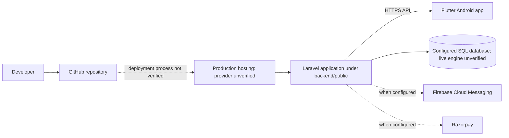
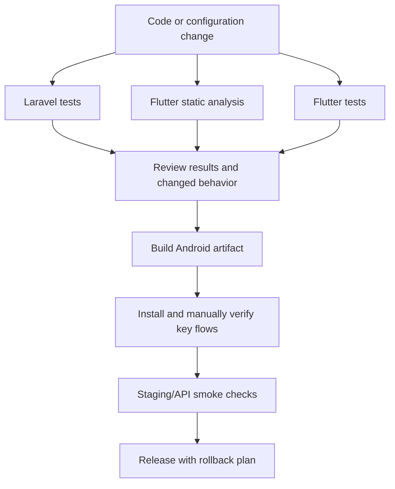

# Deployment, Testing, and Security

This guide separates repository configuration from verified production behavior. It is based on the current backend, mobile, Android, deployment, and test files. No build or test suite was run for this documentation task.

## Deployment evidence

| Item | Evidence/status |
| --- | --- |
| Production domain | `https://smartsociety.codevizor.com` is the configured API host. The public `/api/health` endpoint returned HTTP 200 on 2026-10-19. |
| Hosting provider | A Hostinger deployment guide exists in `deployment/HOSTINGER_DEPLOYMENT.md`; live hosting provider and server configuration were not verified. |
| Production database | Backend supports SQLite and MySQL-family connections. The live engine, schema version, backups, and data were not inspected. |
| Laravel deployment | Source is in `backend/`; the public web root is intended to be `backend/public`. Live document-root, PHP-FPM/web server, permissions, and cache configuration were not verified. |
| Firebase | Flutter Firebase integration and backend FCM service exist. Production credentials and end-to-end push delivery were not verified. |
| Razorpay | Order/verification/webhook code exists. Live account activation, keys, webhook registration, and a real transaction were not verified. |
| Mobile release | `mobile/android/app/build.gradle.kts` uses a release keystore when `key.properties` exists; otherwise it signs a release build with the debug signing config. The distributed APK and its signing identity were not checked. |

The repository contains a tracked Android release keystore file. Its contents are intentionally not displayed here. Treat the signing material as exposed to anyone with repository access; review its access and rotation implications before using that key for a public release. A production signing setup should keep the keystore and `key.properties` outside source control and use protected build secrets.

## Local development setup

### Requirements

- PHP `^8.3`, Composer, and the PDO extension for the selected database.
- Flutter/Dart compatible with the constraints in `mobile/pubspec.yaml` (Dart `>=3.4.0 <4.0.0`).
- Android SDK and ADB for Android builds and physical-device use.
- A local database supported by `backend/config/database.php` (SQLite or MySQL/MariaDB).

### Backend

```powershell
git clone https://github.com/Swanand-Pawar-94/smart-society-final.git
Set-Location smart-society-final/backend
composer install
Copy-Item .env.example .env
```

Edit `.env` for the local machine. Set a unique `APP_KEY` with `php artisan key:generate`, configure a local database and mail transport as needed, then run:

```powershell
php artisan migrate
php artisan serve --host=0.0.0.0 --port=8000
```

Migrations change the target database. Back up any database containing useful data and confirm the connection before running them; do not use a production database for local experimentation. The default database connection is SQLite, while the checked-in environment template includes MySQL-oriented placeholders.

### Flutter app

```powershell
Set-Location ..\mobile
flutter pub get
flutter run --dart-define=API_ENV=emulator
```

For an Android emulator, `API_ENV=emulator` uses the host bridge address. For a USB-connected device, start the backend, enable USB debugging, and run `adb reverse tcp:8000 tcp:8000`, then launch with `--dart-define=API_ENV=usb`. For a phone on the same network, use a reachable computer IP:

```powershell
flutter run --dart-define=API_ENV=lan --dart-define=API_BASE_URL=http://<HOST-IP>:8000/api
```

Firebase initialization can require the platform Firebase client configuration. Android applies the Google Services Gradle plugin only when `mobile/android/app/google-services.json` exists. Do not distribute private Firebase service-account credentials with the app; the backend service account belongs in protected server configuration.

### Local and production settings

| Setting | Local development | Production intent |
| --- | --- | --- |
| API URL | Emulator bridge, USB reverse, or LAN host, typically HTTP | `https://smartsociety.codevizor.com/api` |
| Laravel debug | May be enabled locally | `APP_DEBUG=false`; use HTTPS |
| Database | Disposable local SQLite or developer database | Protected server database; actual production configuration unverified |
| Firebase | Optional for local database-notification flows | Server credentials and Flutter client config required for push delivery |
| Razorpay | Tests/demo behavior depends on configuration and `PAYMENT_MODE` | Server-only live credentials and verified webhook setup; not verified |
| Signing | Debug signing is suitable for local install | Protected release key configured through ignored `key.properties`; current fallback is debug signing |

The app's configured production build command is:

```powershell
flutter build apk --release --dart-define=API_ENV=production --dart-define=API_BASE_URL=https://smartsociety.codevizor.com/api
```

The expected APK output is `mobile/build/app/outputs/flutter-apk/app-release.apk`. The repository contains both an in-repository release keystore and a debug-signing fallback in Gradle; resolve signing-key handling before publishing a release. No APK was built as part of this documentation work.

## Production deployment outline

The existing provider-specific instructions are in [deployment/HOSTINGER_DEPLOYMENT.md](../deployment/HOSTINGER_DEPLOYMENT.md), with Flutter configuration notes in [deployment/flutter/production_config_guide.md](../deployment/flutter/production_config_guide.md). They are guidance, not confirmation of the live server's provider or configuration. The repository evidence supports this intended topology only:



Before release, verify PHP 8.3+, Composer dependencies, HTTPS routing, environment variables, writable Laravel `storage` and `bootstrap/cache`, database connectivity, backups, scheduler configuration, and a deployment rollback. Keep `.env`, Firebase service-account credentials, payment secrets, and signing key files outside the public web root and source control. Apply migrations through a reviewed backup-and-release procedure rather than an ad hoc production command.

Laravel registers `maintenance:generate` every minute in `backend/routes/console.php`. Enabling the Laravel scheduler therefore runs that command at that cadence. Confirm that the resulting billing behavior is intended and safe for the production database before enabling it.

The health endpoint's HTTP 200 response is a limited smoke check; it is not a deployment acceptance test. Verify login, role-scoped flows, database-backed operations, FCM (if required), and payment provider behavior in an appropriate staging environment before release.

## Testing and quality workflow



The repository contains backend feature/unit tests covering authentication, authorization, visitors, notifications, maintenance, payment orders/Razorpay, residents/flats, complaints/notices, parcels, dashboards, and penalties. The Flutter `mobile/test/` suite includes login/roles, residents, visitor workflow, navigation, payment overflow, penalties, time selection, and a widget smoke test. Tests are available but were **not executed** for this documentation update.

```powershell
# Backend suite
Set-Location backend
php artisan test

# Examples of focused backend test selection
php artisan test --filter=Visitor
php artisan test --filter=PenaltyManagement
php artisan test --filter=RazorpayPayment

# Flutter checks
Set-Location ..\mobile
flutter analyze
flutter test
flutter build apk --release --dart-define=API_ENV=production --dart-define=API_BASE_URL=https://smartsociety.codevizor.com/api
```

Build and device installation are separate verification steps: a successful source build does not verify that a particular phone displays the expected app or that production services are configured.

## Security controls and known gaps

### Implemented controls

- Laravel Sanctum bearer tokens protect authenticated API routes. Passwords use Laravel's hashed model cast; password reset invalidates existing tokens.
- Role middleware, controller checks, and ownership filters scope many resident, staff, security, and administrator workflows.
- Laravel Form Requests and controller validation constrain route input. Database foreign keys, unique indexes, transactions, and row locks are used in selected workflows; see [Data model and business rules](DATA_MODEL.md).
- Payment verification validates a Razorpay order/payment signature before recording payment. Webhook requests validate the configured webhook signature. Payment order reconciliation uses locking/idempotency checks.
- Penalty evidence is served from its configured storage disk only after report authorization and with `X-Content-Type-Options: nosniff`.
- Environment templates use placeholders. Firebase service-account and Razorpay secrets should be kept server-side and out of Git/mobile artifacts.

### Gaps to account for

- `GET /api/penalty-reports` is authenticated but does not explicitly reject `STAFF` or other non-admin/non-security/non-resident roles before returning the query. The current code only adds role-specific filters for `RESIDENT` and `SECURITY`; review this authorization gap before relying on the endpoint for confidential reports.
- `GET /api/debug-info` is public and exposes request/environment diagnostics. Review whether it should remain reachable in a production deployment.
- Android's main manifest allows cleartext traffic. Production builds must use HTTPS API URLs; this flag is not transport security.
- `backend/.env.example` does not enumerate Firebase environment names despite the service reading them. Set required variables through protected deployment configuration.
- Penalty rule bounds, grace period, and `requires_evidence` are stored but not enforced by the current decision handler; admin-entered amount is used. See the [penalty workflow](WORKFLOWS.md#penalty-management--actual-rules-and-gaps).
- Parcel controller routes duplicate workflow-service behavior; the routed collection action does not use the service's locking path or send the service's collection notification. See [module caveats](WORKFLOWS.md#other-module-workflows).
- Live database, external provider credentials, hosting topology, production signing identity, and full deployed workflow status remain unverified.

## Troubleshooting

| Symptom | Checks |
| --- | --- |
| Phone cannot reach local API | Confirm phone and computer share a network, use the computer's LAN IP, allow the development port through the local firewall, and verify `/api/health`. For USB use `adb reverse`; for emulator use the emulator preset. |
| API returns database errors | Check `DB_CONNECTION` and database credentials in the backend's local `.env`, the database service, and the matching PHP PDO extension. |
| Push notifications do not arrive | Confirm Firebase client configuration is present in the app, server project/service-account settings are valid, device token is registered, and the device grants notification permission. Database notifications can still work without FCM. |
| Razorpay checkout unavailable or fails | Confirm the intended payment mode, server-side key configuration, callback/signature values, and provider dashboard/webhook settings. Do not put the secret in Flutter. |
| Laravel cannot write cache/logs/files | Check permissions for `backend/storage` and `backend/bootstrap/cache` in the deployment environment. |
| Release has wrong API target or signing | Rebuild with the intended `--dart-define` values and verify protected release signing configuration before distribution. |
