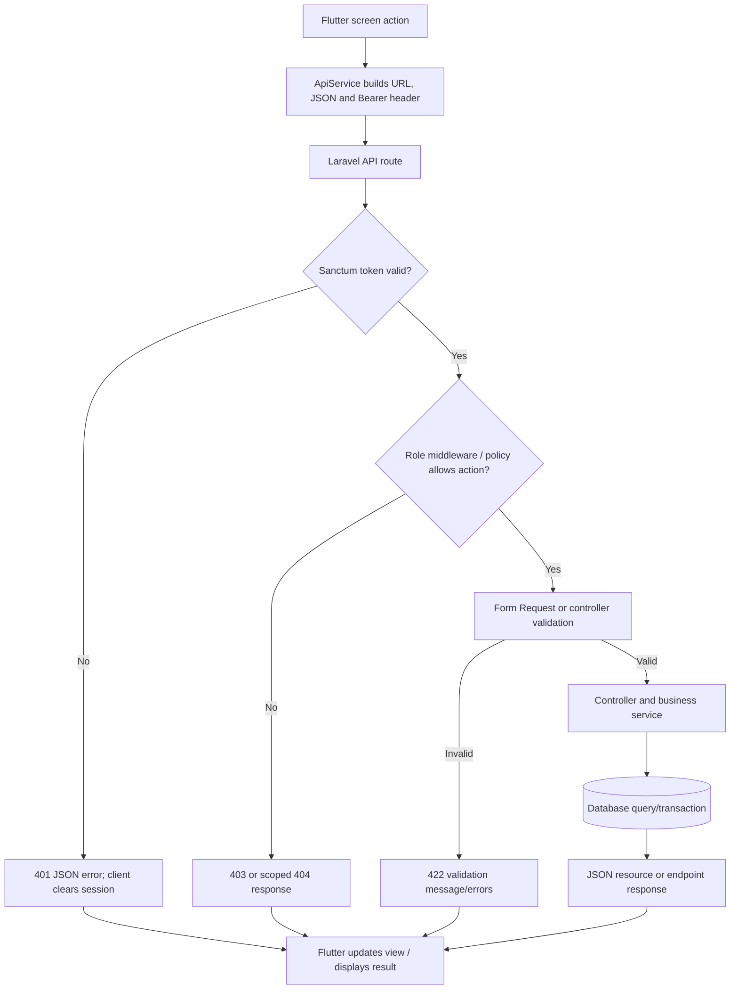
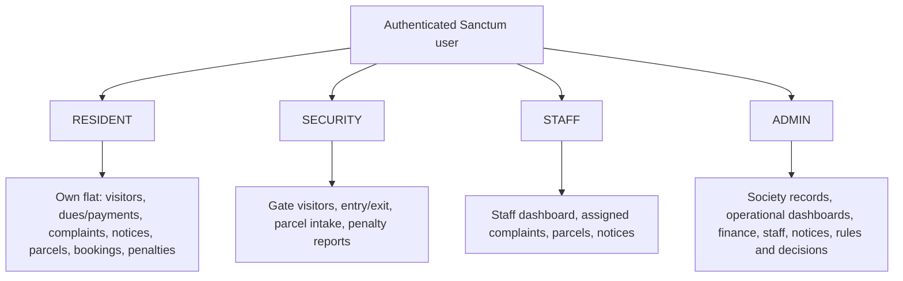
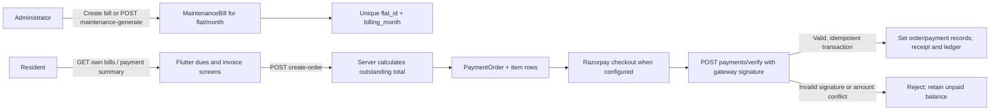

# Nivora Architecture and Workflows

This guide describes the code paths currently present in `mobile/lib`, `backend/routes`, Laravel controllers/services, models, migrations, and tests. A path being implemented does not establish that its external provider is configured in production. Deployment verification is in [DEPLOYMENT_TESTING_SECURITY.md](DEPLOYMENT_TESTING_SECURITY.md).

## Application structure and navigation

The Flutter application is bootstrapped in `mobile/lib/main.dart`. It initializes Firebase, creates an `AuthController` and shared `ApiService`, restores any stored token, and chooses role-specific dashboard shells after authentication. Most record modules use the shared `ModuleScreen`, `RecordDetailScreen`, and `ModuleFormScreen` in `main.dart`; the visitor gate flows, transaction history, and penalty management have dedicated screens under `mobile/lib/screens/`.

| Role | Main shell and dashboard | Module navigation in the client |
| --- | --- | --- |
| Resident | Resident shell and `resident/dashboard` | Unit/profile, visitors and pre-approval, maintenance/dues, payment activity, complaints, notices, parking, parcels, amenities/bookings, messages, notifications, penalties. |
| Security | Security shell and `security/dashboard` | Visitors, dedicated check-in/check-out/history screens, parcels, notices, messages, notifications, penalty reporting. |
| Staff | Role home and `staff/dashboard` | Complaints assigned to the staff member, parcels, notices, messages, notifications. |
| Admin | Admin shell and `admin/dashboard` | Residents, flats, visitors, maintenance and payment orders, reports, complaints, notices, staff, parking, parcels, amenities/bookings, messages, notifications, penalty dashboard/rules/reports/appeals. |

The client checks returned roles for navigation and sends the optional `requested_role` on login. Backend route middleware and per-record policies remain the authorization boundary.

## System architecture

```mermaid
flowchart LR
    subgraph Client[Flutter Android client]
        UI[Role dashboards and module screens]
        Auth[AuthController and secure token storage]
        API[ApiService and ApiConfig]
        Push[Firebase Messaging and local notifications]
        UI --> Auth --> API
        Push --> UI
    end

    subgraph Server[Laravel API]
        Routes[API routes]
        Sanctum[Sanctum authentication]
        Role[Role middleware and policies]
        Validate[Form Requests and validation]
        Domain[Controllers and domain services]
        Routes --> Sanctum --> Role --> Validate --> Domain
    end

    DB[(Configured SQL database)]
    FCM["Firebase Cloud Messaging HTTP v1<br/>when credentials are configured"]
    RZ["Razorpay API<br/>when server keys are configured"]
    Hosting["Production domain<br/>Hostinger is described by a guide, not verified"]

    API -->|JSON over HTTP(S), Bearer token| Hosting
    Hosting --> Routes
    Domain --> DB
    Domain -->|FCM send| FCM
    FCM --> Push
    API -->|Checkout launch and payment result| RZ
    Domain -->|Order create and signature verification| RZ
```

`ApiConfig` selects LAN, USB reverse, emulator, custom, or production base URLs. `ApiService` sends JSON requests with the bearer token, maps JSON error messages into `ApiException`, and clears the local session after a 401 through its unauthorized callback. File uploads use multipart requests. Backend validation errors commonly return Laravel's `message` and `errors` shape; resource responses use Laravel JSON resources, while other controllers return endpoint-specific `data`/`message` JSON.

## Authenticated request lifecycle



Not every endpoint has a dedicated Form Request class; some validate inline. Do not treat an HTTP 200 health response as proof that protected workflows or external integrations work.

## Roles and access



| Module | Resident | Security | Staff | Admin |
| --- | --- | --- | --- | --- |
| Visitor list/actions | Own flat; approve/reject/pre-approve | Create requests; entry/exit/history | — | View all |
| Bills and payment records | Own flat; create payment orders | — | — | Manage bills/orders/payment status |
| Complaints | Create/update own details | — | View/update assigned complaints | View/update and assign staff |
| Parcels | View own | Receive/collect | Receive/collect | View/receive/collect |
| Notices | Read audience-matched published notices | Read notices | Read notices | Create/update/publish |
| Amenities/parking | Book amenities; view slots | — | — | Manage amenities, bookings, slots |
| Penalties | Own report list, appeal, payment | Create reports; see own reports | — | Configure rules, decide reports/appeals |
| Messaging/notifications | Authenticated user endpoints | Authenticated user endpoints | Authenticated user endpoints | Authenticated user endpoints |

Exact access is also enforced by `EnsureUserHasRole`, route groups, `Gate` policies, and ownership checks. A route's existence does not imply that each role can use it.

## Authentication and account lifecycle

```mermaid
sequenceDiagram
    actor User
    participant App as Flutter app
    participant Auth as AuthController
    participant API as Laravel AuthController
    participant DB as SQL database
    User->>App: Enter login and password / choose requested role
    App->>Auth: login(login, password, requested_role)
    Auth->>API: POST /api/auth/login
    API->>DB: Find email or phone; verify hashed password and account status
    API-->>Auth: 200 {message, data: {token, token_type, user}}
    Auth->>Auth: Save token in flutter_secure_storage (if remember enabled)
    Auth->>API: Register device token when Firebase returns one
    App->>User: Open dashboard selected from returned role
```

- Public registration permits `RESIDENT`, `STAFF`, and `SECURITY`; it does not permit `ADMIN`.
- Resident registration requires `flat_number` and `building`. It finds or creates a flat by that pair, marks it occupied, creates the resident relationship, and returns a message that the new account can sign in.
- Staff/security registration creates a staff member in `INACTIVE` status. An administrator must activate it before login is allowed. Required fields differ by role (for example security registration requires `employee_id` and `shift`; staff registration requires a designation).
- Passwords require confirmation and at least eight characters with mixed case and a number. The `User` model uses Laravel's hashed password cast.
- Startup reads the stored token and requests `GET /api/auth/me`. An invalid token is deleted. A 401 during normal requests clears the session.
- Logout attempts device-token deactivation and server logout, then clears local storage/session even if the API is unavailable. The backend logout deletes the user's tokens.
- Forgot-password sends a Laravel password reset link using the configured mailer. Reset requires `token`, `email`, `password`, and `password_confirmation`; successful reset invalidates existing tokens. Email delivery depends on server mail configuration.

## Visitor lifecycle

```mermaid
sequenceDiagram
    actor Guard as Security user
    participant App as Security screen
    participant API as Laravel visitor workflow
    participant DB as Database
    actor Resident
    participant RApp as Resident app
    Guard->>App: Select flat/resident; enter visitor name and type
    App->>API: POST /api/security/visitors
    API->>DB: Create PENDING approval + WAITING entry record
    API-->>RApp: Database notification to flat residents; attempt email
    Resident->>RApp: Approve or reject (optional reason on rejection)
    RApp->>API: PATCH /api/resident/visitors/{id}/approve or /reject
    API->>DB: Change approval state; notify requesting security user
    Guard->>App: Check in approved/expected visitor
    App->>API: PATCH /api/security/visitors/{id}/entry
    API->>DB: Lock record; set ENTERED and entered_at
    API-->>RApp: Record check-in notification
    Guard->>App: Check out visitor currently inside
    App->>API: PATCH /api/security/visitors/{id}/exit
    API->>DB: Lock record; set EXITED, COMPLETED and exited_at
    API-->>RApp: Record check-out notification
```

For a pre-approval, the resident supplies a visitor name, visitor type, and future `expected_at`; the record starts `EXPECTED`, `APPROVED`, and `is_pre_approved=true`. Security check-in lists approved records that have not entered. Entry and exit run inside transactions using `lockForUpdate`; a second check-in/check-out is rejected. A resident may only act on a visitor tied to their flat. Gate creation validates the selected flat and resident association. On gate requests, in-app alerts go to residents linked to the flat; an email with signed approve/reject links is also attempted for the selected resident. Email and FCM failures are logged and do not represent guaranteed delivery.

Useful filters on visitor list routes include `q`, `approval_status`, `entry_status`, `visitor_type`, `flat_id`, and security's `eligible_for_check_in`.

## Maintenance and payment tracking



Administrators can create or update bills with a total or component charges (`base_maintenance`, water, common electricity, parking, other charges, late fee, discount). When components are provided the backend calculates the amount. Billing month must be the first day of that month; `flat_id + billing_month` is unique. The `maintenance:generate` command and admin generation endpoint create monthly bills according to the command/service logic; recurring execution requires a scheduler. The current scheduler declaration is every minute, so confirm that cadence before enabling it in a production environment.

Residents see only bills for their flat. The server computes outstanding balances and order totals; a client-supplied amount is not authoritative. Direct maintenance-payment records support tracking/admin workflows separately from Razorpay. Razorpay orders use a server-held key/secret, and verification checks an HMAC signature before recording payment, receipt, and transaction ledger entries. Payment order transitions and gateway verification use database transactions/locks and duplicate references are constrained. Demo confirmation is available only when `PAYMENT_MODE=demo`.

The actual production key mode, merchant activation, webhook configuration and live transaction result are unknown. See [API Reference — payments](API_REFERENCE.md#maintenance-and-payments) and [Payments](../README.md#payments).

## Penalty management — actual rules and gaps

Penalty code is in `PenaltyController`, `PenaltyRule`, `ViolationReport`, `Penalty`, `PenaltyAppeal`, and the penalty migration.

1. An administrator creates/updates a rule with category, violation type, description, amount bounds, late-fee amount/grace period, evidence flag, and active flag. `(category, violation_type)` is unique. Residents/security can retrieve only active rules; administrators can list all rules.
2. Security submits an incident report with category/type, incident time, location, description, and optional flat/parking slot/bill/booking links and up to five JPG/JPEG/PNG/WEBP/PDF evidence files (10 MB each). The report begins `reported`; the controller does not attach a rule (`rule_id` is null) or assign a resident at this stage. A fingerprint over category, type, flat, UTC incident time, and normalized location prevents duplicate reports.
3. An administrator decides a `reported` or `under_review` report as `under_review`, `warning_issued`, `approved`, or `rejected`, with a required reason. For `approved`, the administrator must explicitly choose a resident whose `flat_id` matches the report flat and provide a positive `disciplinary_amount`. Repair cost is optional, but if positive the report must have evidence. The controller currently initializes `late_fee_amount` to zero.
4. **Rules do not currently determine/validate the assigned penalty amount.** Although rule minimum/maximum, grace period and `requires_evidence` are stored, the decision handler does not use those fields to calculate or enforce the approved amount/evidence rule. It does not require an active rule to approve a report. The admin-entered amount is the operative amount, and evidence is required specifically for a positive repair cost.
5. Approval creates one penalty per report with status `approved` and payment status `unpaid`, records decision/actor/time and audit data, then sends a database notification after commit to the assigned resident. Other terminal report decisions also notify the resident if one was assigned.
6. The resident sees only reports associated with them, can submit an appeal with reason and optional evidence while the penalty is approved, or start a payment order for an approved unpaid penalty. Only one currently open appeal (`submitted`/`under_review`) is allowed by a pre-check; the schema does not define a unique constraint for that rule. The admin can decide an appeal as `upheld`, `waived`, `adjusted`, or `rejected`. Waive/adjust is rejected for already-paid penalties because no refund workflow exists. The decision resolves the report and notifies the resident. The paid penalty remains recorded as paid for `upheld`/`rejected`.
7. Penalty payment creates/reuses a Razorpay order only if the gateway is configured. Successful server-side payment verification marks the penalty paid and records an audit entry/notification. Missing gateway config returns 503; checkout creation alone does not mark it paid.

Report evidence is stored on the private/local disk and the evidence endpoint authorizes access as admin, the reporting security user, or the resident assigned to that report. Evidence is served with `nosniff`. Tests cover authorization, report assignment, duplicate reporting, evidence scoping, appeals, and payment idempotency; they do not establish live gateway operation.

## Other module workflows

| Module | User action and backend behavior | Current controls / caveats |
| --- | --- | --- |
| Parcels | Security/staff/admin select a flat and resident, enter courier/type and optional tracking/notes; backend checks the resident belongs to the flat and creates a received/awaiting record. Authorized staff/security/admin mark pickup, recording collector and timestamp. | Resident reads are scoped to own resident ID. Status transition rejects already-collected parcels. `ParcelWorkflowService` includes transaction/lock/idempotency and collection notification handling, but the routed `ParcelController` duplicates the workflow and does not call that service. Its collection action does not use the service lock or send the service's collection notification. Creation sends a database notification. Actual push depends on Firebase. |
| Complaints | Resident creates category/title/description/priority; backend associates current resident and flat, initializes `OPEN`, writes status history, and notifies admins. Admin can assign staff and update status; assigned staff can update status/note. | Resident can view/update only their own complaint; staff sees assignments. Status transitions are allow-listed and status history is stored. Status changes notify resident; assignment notifies staff. |
| Notices | Admin creates draft/published notice, audience, category/priority and optional schedule/expiry. Published-now actions alert the selected audience. Readers only receive notices published by current time, not expired, and matching audience. | Existing audience values: `ALL`, `RESIDENTS`, `OWNERS`, `STAFF`. The `STAFF` alert audience includes security. A published notice with future `published_at` remains scheduled. |
| Amenities | Admin manages facility name, active flag, booking duration and opening/closing fields. Resident requests date/time; backend locks the amenity row, checks active status, duration, and overlapping active booking intervals, then creates `CONFIRMED`. | Resident can cancel own booking; admin can change booking status. Current booking code does not enforce configured opening/closing times, only active, duration and overlap. |
| Parking | Admin manages slot number, type, optional flat and vehicle; residents view parking slots. | Slot number is unique. Status/type options are in the API/UI; there is no dedicated security vehicle movement workflow in the current routes. |
| Messaging | Authenticated users list/create conversations, read a conversation, send a message, and mark it read. | API checks conversation participation. No websocket/broadcast transport is configured, so do not describe it as real-time. |
| Staff | Admin creates/manages staff profiles and toggles status; login rejects inactive staff/security records. Staff dashboard and assigned complaints are role-scoped. | The public register flow also allows staff/security applications, which stay inactive until activated. |
| Dashboards/reports | Each role calls its dashboard endpoint; admins can query report aggregates. | Dashboards are API-backed summaries and are not a separate analytics warehouse. |

## Notifications and background services

- Flutter initializes Firebase, requests/receives FCM tokens, observes token refresh, sends tokens to `POST /api/device-tokens`, and deactivates them on logout. Foreground messages can be displayed with `flutter_local_notifications`.
- Laravel stores database notifications and has `FirebaseCloudMessagingService` for FCM HTTP v1. It needs `FIREBASE_PROJECT_ID` and a private service-account file configured via `FIREBASE_CREDENTIALS_FILE`. Push delivery is best effort and credentials were not verified here.
- Visitor requests additionally attempt an email using signed links that expire after 24 hours. This requires a working mail transport.
- Laravel scheduler declares `maintenance:generate` in `backend/routes/console.php`; production scheduling requires a host scheduler runner.

## Error and edge behavior

| Condition | Observed behavior |
| --- | --- |
| Invalid login credentials | JSON message with HTTP 422; role mismatch/inactive staff uses 403. |
| Expired/invalid bearer token | 401; client unauthorized callback clears stored session. |
| Role denied | 403 from middleware/policy. Some scoped penalty reads return 404 to avoid exposing another user's records. |
| Validation / invalid lifecycle transition | Usually 422 with message and/or field errors. |
| Offline or timeout | Client throws `ApiException` with connectivity guidance; no HTTP response is available. |
| Razorpay not configured for penalty payment | 503 with `PAYMENT_GATEWAY_NOT_CONFIGURED`. |
| FCM failure | Logs warning/error; database workflow should continue for visitor events covered by tests. |

Response bodies are not globally normalized: use the specific resource/controller for exact fields. Laravel API resources generally wrap an item/list in `data`; paginated resource collections include `data`, `links`, and `meta`. Inline controller responses vary.
